## 1. Title and Author

- Forecasting DC Pavement Condition Using HPMS Data
- Prepared for UMBC Data Science Master Degree Capstone by Dr Chaojie (Jay) Wang
- Connor Bruce
- [Project GitHub](https://github.com/ConnorBruce/UMBC-DATA606-Capstone) 
- [LinkedIn](https://www.linkedin.com/in/connormbruce/) 
- Link to your PowerPoint presentation file
- Link to your YouTube video 
    
## 2. Background

Transportation agencies such as State DOTs generate tons of data about their pavements, bridges, and ancillary assets and this data is extremely valuable for planning their funding and allocating their resources to ensure their transporation network functions properly and safely. Included in this data is the condition and traffic load on their network's pavement. This project intends to use that data to predict pavement deterioration based on the pavement designation and traffic load on Washington DC's pavement network. 

Similar analyses to this are used by these transporation agencies to make data-informed decisions on where to initiate construction projects to restore and reconstruct stretches of pavements. Pavements in good condition are both safer and financially advantageous to the community as there is less wear and tear on the vehicles that drive on them. Additionally, transportation agencies have limited funding, especially federal, so it's critical to optimize the funds they have to maximize the improvement to their transportation network.

Some questions this research hopes to answer are how traffic affects the deterioration of pavements taking into account the surface type of the pavement and the pavement's designation. Further, a secondary question this aims to answer is what the network will look like in the future. Using the Highway Performance Monitoring System (HPMS) data from 2016-2024, a model will be built that predicts and applies a deterioration rate to the pavement and, assuming no work is done on the pavement, can predict out multiple years.

## 3. Data 

**Data Source:** [DC HPMS Data](https://hub.arcgis.com/datasets/0a0342b71f80483d810fed44afd86014/about) (282.8 MB)

**Data Shape:**
- Pre-processed: 1,727,332 rows x 40 columns
- Post-processed: 20,820 rows x 12 columns

**Data Time Period:** 2015-2024

**Data Description:**
- Contains the HPMS submittal data from 2015 to 2024 for DC in geodatabase format.
- When all years joined, each row represents a section of highway for a given year and includes information about road designation, traffic, and pavement condition

**Data Dictionary:**
| Column Name  | Data Type  | Definition  | Potential Values  |  
|---|---|---|---|
| ROUTE_ID  |  Character |  Route Designation Identifier | Any alphanumeric combination  |   
| BEGIN_POINT  | Numeric  | Mile marker of starting point for section  | Any real number >= 0 and less than END_POINT  |  
| END_POINT  |  Numeric | Mile marker of ending point for section  | Any real number > 0 and greater than BEGIN_POINT  |   
| YEAR_RECORD  | Integer  | Year of given observation  | Integer between 2015 and 2024, inclusive  |  
| AADT  | Integer  | Average Annual Daily Traffic. Average number of cars that drove on given section of road per day for given year  |  Integer >= 0 |   
| IRI  | Integer  | Internation Roughness Index (IRI) value for given section. In units of in/mi  |  Integer >= 0 |
| F_SYSTEM  |  Integer | Code for functional system of given section. (e.g. Interstate, Major Arterial, Minor Arterial)  | Integer between 0 and 7, inclusive  |   
| NHS  |  Integer | Indicates whether the road is part of the National Highway System (NHS)  | Integer between 0 and 7, inclusive  |   
| SURFACE_TYPE  |  Integer | Code for material of given section's pavement surface  | Integer between 0 and 11, inclusive  | 
| IRI_DELTA  |  Integer | Year-over-year change in IRI, in in/mi  |  Integer >= 0 |   
| AADT_DELTA  | Integer  |  Year-over-year change in AADT | Integer >= 0  |

**Machine Learning Model Target:** The target field for the model will be the IRI Delta, or the year-over-year change in IRI. This value is critical for predicting the rate of deterioration for an agency's pavement, allowing them to anticipate where to allocate resources to optimize system improvement.

**Features and Predictors:**
- AADT: Traffic causes wear and tear on a road and is useful for estimating changes in pavement condition
- F_SYSTEM: Different functional classes recieve different amounts of attention and repairs, therefore, it is helpful to include this feature to include these differences.
- NHS: Similar to functional class, pavements on the NHS are required to recieve a certain amount of funding and are typically given more repairs and funding. Additionally, highway traffic is different than other road's traffic.
- SURFACE_TYPE: Different surface types (e.g. Asphalt vs. Concrete) behave differently over time.
- AADT_DELTA: Changes in traffic over time can affect pavements, especially in flexible asphalt pavements.
- IRI: Roads in different conditions may deteriorate at different rates.

## 4. Exploratory Data Analysis (EDA)

### Data Processing and Cleaning
The EDA performed on the data was primiarily used to determine how to best filter and process the data for modelling. The EDA included summary statistics on the available data, outlier analysis, and GIS mapping to better visualize the data and inspire how to best utilize the final models.

Before EDA, the first thing that had to be done was processing to combine the different datafiles with each representing a year's worth of data. Initially, a simple left join on the route and mile markers was attempted but it was discovered that the mileposts had slight changes between years. Therefore a new method had to be used to join the data. To do this, the most recent year's data (2024), was defined as the "base" year. For all other years, the data was joined by their ROUTE_ID and then all other years' sectioning was fit within the "base" sectioning. When multiple sections fell within a "base" section, a weighted average based on the percentage overlap was used for numeric variables and the largest percentage overlap section was used for categorical variables. This resulted in a dataset where each record represeted the condition and road features for a given section for a given year.

Once joined, the data was filtered to only include records that were located in Washington DC. This cut down the record count significantly. Next, the data was filtered to remove records where there was missing data for any of the features. With those remove, the target variable, the year-over-year change in IRI, was calculated by dividing the change in IRI between subsequent years for a given section by the number of years in between records. The earliest year had to be removed because there were no prior years to calculate the difference in IRI. Similarly, the change in traffic was calculated using the AADT field. Finally outliers were removed. In general the IRI of a pavement will not increase by more than 100 in/mi per year and will typically not decrease. Therefore it was filtered such that the IRI delta did not exceed 150 in/mi or decrease by more than 20 in/mi. This range is slightly beyond the typical increase/decrease to account for valid extreme cases. Similarly, the IRI typically does not exceed 500in/mi so it was filtered to remove records where the IRI was above 750in/mi which similarly allowed for valid extreme cases. The result served as the final dataset for modelling.

### Mean Distributions
Some insights were then gained from the dataset. The first thing that was looked at was the general distributions of the IRI and the target variable, IRI Delta. There was a general decreasing trend for both which was useful in evaulating the model. It was also discovered that the IRI delta data from 2018 was an outlier which helped to inform the filters that were used for the final dataset. The following two figures show those charts.

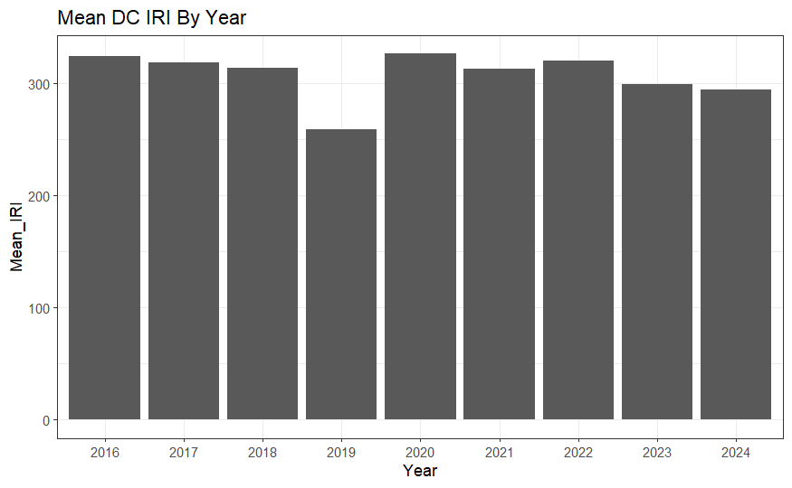

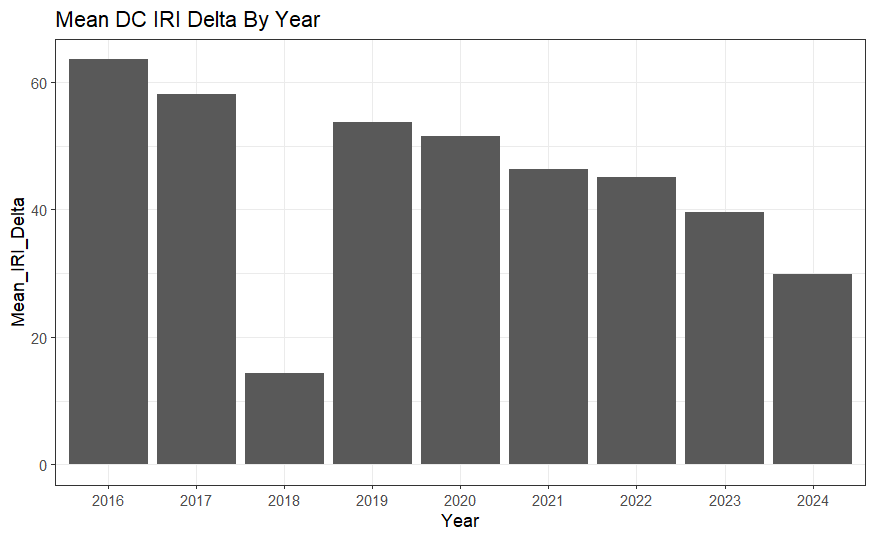

### Count Distibutions
In addition to looking at distributions for the means, distributions for the categorical factors were explored. The first was how the NHS status and IH status were distributed. It is important to note that if a road is an interstate, it will also be on the National Highway System. The results, summarized in the following table, confirms this as well as shows that most roads are on neither the NHS or IH meaning the model may not have as much data to learn from for these designations.

||Off NHS|On NHS|
|---|---|---|
|Non-Interstate|14,683|5,608|
|Interstate|0|529|

The distribution of surface type was also explored and it was discovered that the vast majority of the pavements were asphalt. This could cause issues with model accuracy for concrete pavements. The following chart shows the distribution.

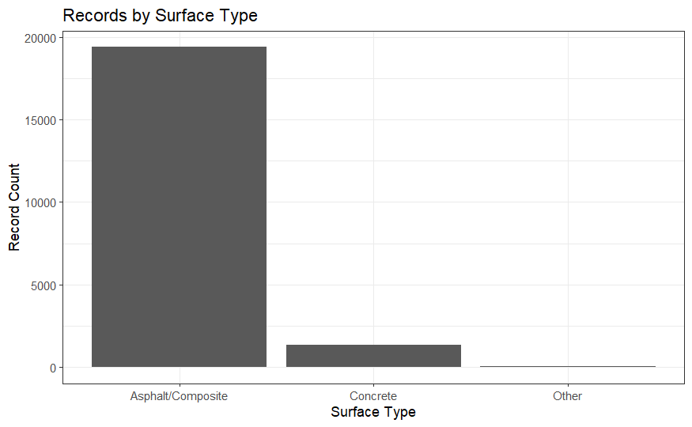

### Correlation Analysis
A correlation matrix was developed to get an idea of any cross-correlation within the dataset. The results are shown in the following figure. The highest correlation was expectedly between the IRI and its delta as well as the AADT and its delta. There are slight correlations between the IH and NHS due to the fact that a pavement on the IH is also on the NHS. A surprising discovery is that there is a negative correlation between the condition of the pavement and the traffic load of the pavement. This does not necessarily mean that traffic improves pavemetn condition, but instead that pavements that have high traffic likely recieve more funding and better care than the lesser used roads.

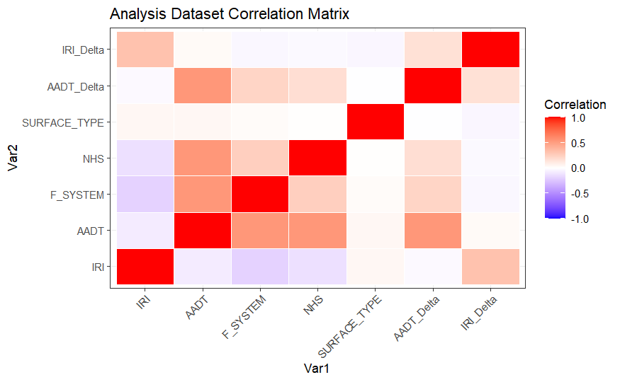

### Maps
To better visualize the data and explore options for the application, color-coded maps were created to show the locational distribution of the NHS status, IH status, and 2024 pavement condition. The aesthetics of the pavement condition were utilized for the application due to the ability to get a view of the network at a glance. 

#### NHS Map
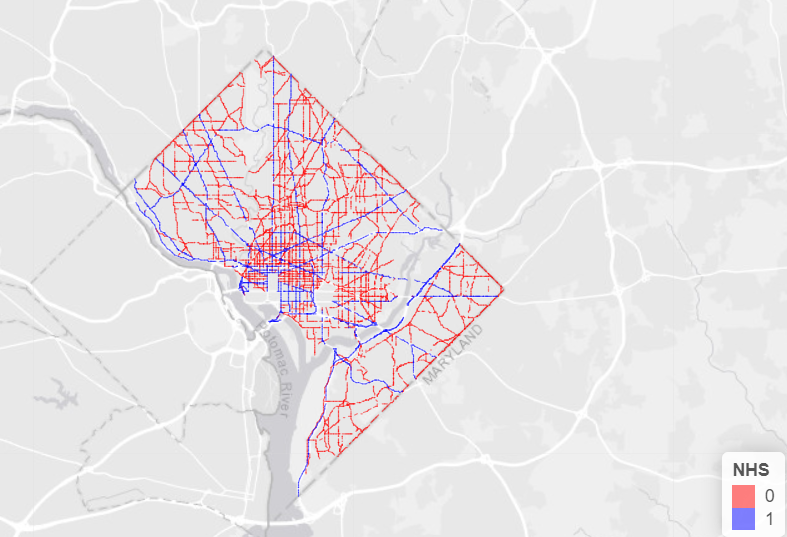

#### IH Map
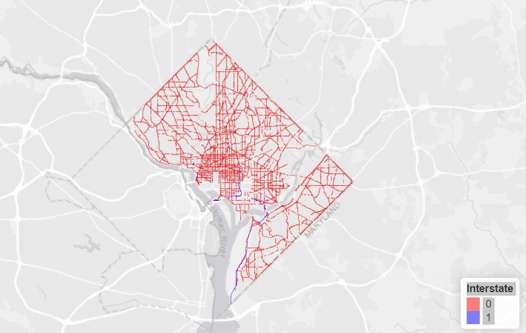

#### 2024 Condition Map
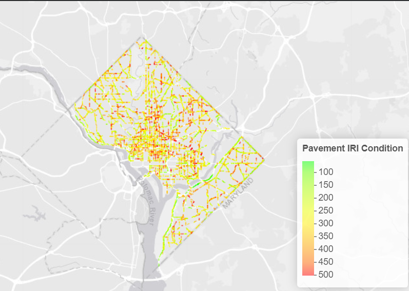

## 5. Model Training 

During the development of the final model, three different models were tested: Linear Regression, Random Forest, and XGBoost. Each was tested at the standard 80/20 split and evaulated based on their accuracy with respect to the testing set. To develop the models, the caret, randomForest, and xgboost R packages were utilized. For the XGBoost model, the reshape2 package was used to encode the data so that it could be properly accepted by the modelling functions. All modelling was done using R in the RStudio environment. 

The following table shows the results for each model:
|Model|RMSE|RSquared|MSE|
|---|---|---|---|
|Linear Regression|40.87|0.129|33.28|
|Random Forest|36.92|0.301|29.03|
|XGBoost|37.69|0.265|28.89|

Based on these results, it was determined that the random forest model would be the model to be used in the application.Testing was done to find suitable parameters such that the model potential was optimized. Ultimately, the r-squared values of the models were lower than desired, however, there is a lot of variability in pavement condition and the age of the pavement is not available despite having a large effect on the condition. Therefore, the decision was made to use the best available model with the knowledge that the model may not have perfect prediction but instead provide a general trend of the data, which is typically the goal of pavement analyses. 

## 6. Application of the Trained Models

The final model was integrated into a web application developed using R Shiny. This application applies the random forest model to simulate deterioration over a user-specified number of years. Before running the model in the tool, the user can filter the data to specificy whether their pavement of interest is on or off the National Highway System and on or off the Interstate Highway system. After the filters are set, the user can click a "Run Model" button after which the application will start with the 2024 data and then loop through the number of defined years during which it will update the IRI of each section then apply the model to the updated values to get the next year's IRI. A progress bar will appear in the bottom right of the windown to indicate that the process is actively running.

Once the simulation is complete, the results will display over two different tabs. The first tab includes a map of the pavement network that is color-coded by the IRI. A dropdown appears that allows the user to select the year to display starting with 2024 through the last year of the simulation. Below the map, there will be a summary table that provides summary statistics for the IRI by route. The second tab includes the post-simulation data in a searchable table so that the user can find specific pavements of interest. The following screenshots show the user interface and available results from the model.

#### Filters
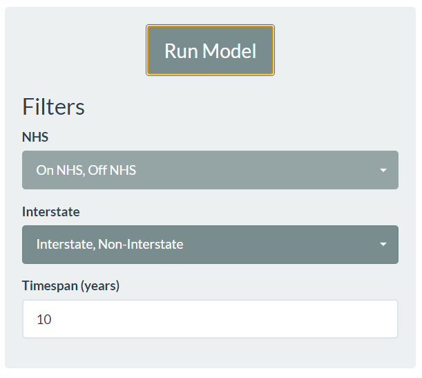

#### Map Tab
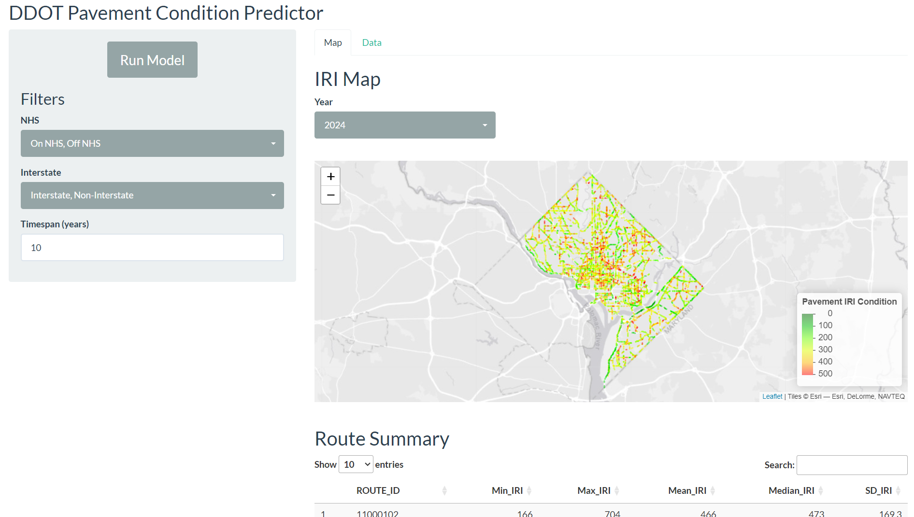

#### Summary
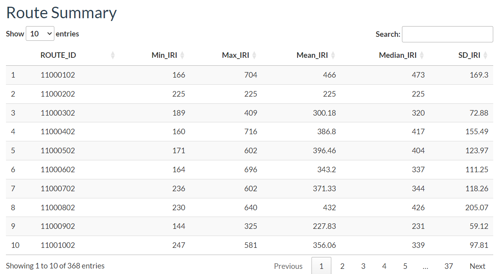

#### Data Tab
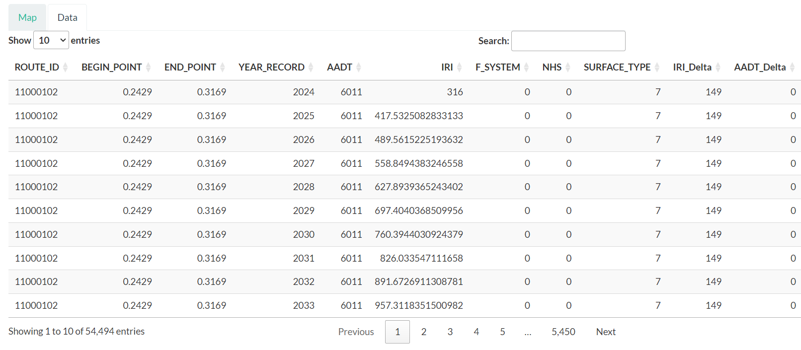

## 7. Conclusion

Overall, the objective to use existing pavement condition data to predict the condition of the pavement in the future was successful. The values generated by the model are reasonable and can be justified. Additionally, the data processing and model building was backed by thourough EDA and outlier analysis. The resulting application is simple, but effective and easy to follow. The information given by the app can be used by pavement engineers to make data-informed decision on creating a timeline for pavements to focus on and allocate funding for repair projects. Additionally, the data provided by the application can be used to justify these decisions.

While the project was successful, there were some limitations that held back some of the potential. The first was the lack of pavement-specific features that could have boosted the accuracy. Things such as soil type, weather, and age of the pavement have a large effect on the condition, but did not have available data to join and utilize. Additionally, as stated earlier, there were some pavement designations and surface types that did not have a sufficeint amount of data to support a model. Finally, much of the data had invalid or missing data causing a large amount of the raw data to be unusable for the modelling. It's likely that the low r-squared values would have been improved with more data.

The main lesson learned from this project was the amount of processing that data requires before it can be used in the modelling process. It is very infrequent that a raw dataset can be initially for EDA or modelling. In this case, the mismatch between each year's dataset required creativity in joining the raw data into a single dataset. There were also lessons learned in finding usefulness in data. It is easy to create charts and graphics, but much more difficult to find useful information in those graphics. This project required the use of EDA and graphics to determine how to best handle outliers and to determine which subsets of data may not have adequate supporting data.

For future improvements for the project, the primary one is bring in the aforementioned features. They may not be publicly available so this would require contacting the proper data owners at DDOT. It would also be useful to explore pavement condition metrics other than IRI. DDOT uses a metric called Pavement Condition Index (PCI) to model many of their local roads and it could help bring to light pavement condition issues not captured by IRI. Similarly, the cracking percentage of pavement is a commonly used metric to make decisions on which roads require maintenance. The application can be made to handle these metrics and allow the user to select which they would like to view as well as add comparisons between the metrics to see relationships between them.

## 8. References 

- HPMS Field Manual: https://www.fhwa.dot.gov/policyinformation/hpms/fieldmanual/

- DC's Open Data Site: https://opendata.dc.gov/

- PaveDC: https://pavedc.ddot.dc.gov/
